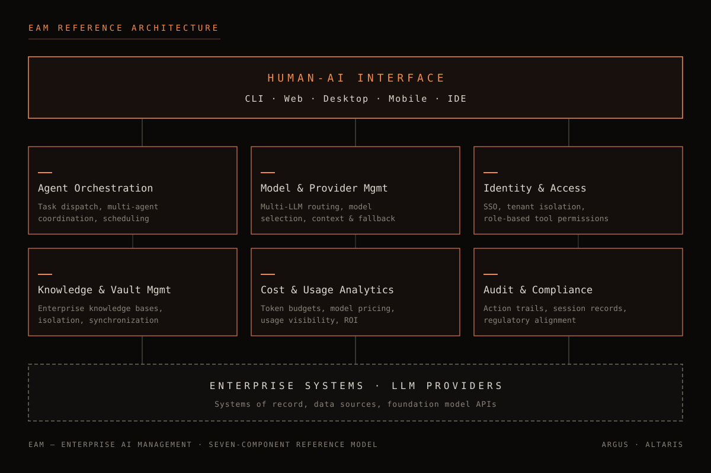
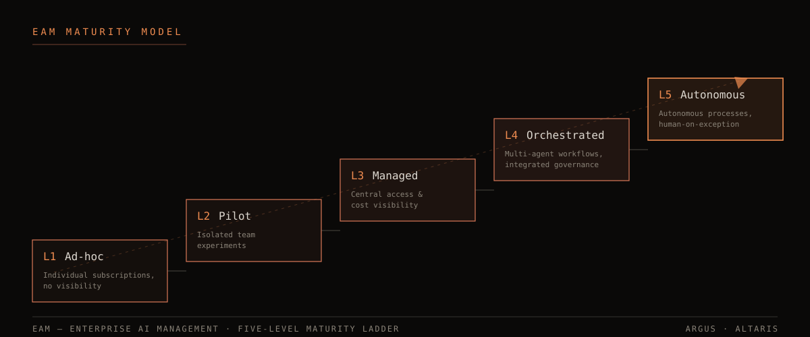

# Enterprise AI Management (EAM): The Missing Operating Layer for Corporate AI

*A category definition and reference architecture — June 2026, v1.0*

**Author:** Burak Demirsoy · Argus Teknoloji A.Ş.

---

## 1. Executive Summary

The history of enterprise software is the history of centralizing what was scattered. Production planning was consolidated by MRP, enterprise resources by ERP, customer relationships by CRM. Today, organizations face a new instance of the same pattern: artificial intelligence is spreading rapidly into every corner of the enterprise — yet no layer exists to plan, manage, and govern it.

This document defines the enterprise software discipline that fills this gap:

> **Enterprise AI Management (EAM):** The enterprise software discipline of planning, managing, and governing an organization's AI assets — agents, models, providers, knowledge bases, access rights, and costs — in a single management layer.

In one sentence: **ERP manages your resources, CRM manages your customer relationships; EAM manages your AI.**

EAM is as much a management discipline as a product category. An organization's EAM maturity determines whether the value it derives from AI is sustainable. Organizations that consume AI at the level of individual tools may capture short-term productivity gains; but without visibility, security, cost control, and auditability, those gains do not scale — and often evaporate the moment they are measured.

This whitepaper does three things:

1. **It names the problem.** It lays out uncontrolled AI proliferation ("AI sprawl") and its organizational costs, supported by current industry data.
2. **It defines the category.** It describes what EAM is, what it is not, and its seven-component reference architecture.
3. **It offers a roadmap.** Through a five-level EAM Maturity Model, it enables organizations to locate themselves and see the next step.

The document is written as a vendor-neutral category definition. In the final section, the Altaris platform is examined as a concrete implementation example, to demonstrate that the reference architecture is buildable in practice.

---

## 2. The Problem: AI Sprawl

### 2.1 Adoption arrived before planning

Enterprise AI adoption has happened at a pace unlike any technology in the history of enterprise software. ERP arrived through multi-year planning cycles, executive decisions, and armies of consultants. AI took the opposite route: it seeped into the organization from the bottom up, through individual subscriptions, often without the IT department's knowledge.

In a typical mid-to-large organization today, the following picture is unremarkable:

- The marketing team has subscribed to a content-generation tool.
- The engineering team uses two different coding assistants; some developers are trying a third on personal accounts.
- An analyst in finance pastes monthly reports into a public chatbot for summarization.
- The sales team uploads customer call recordings to a transcription service.
- Several teams have built their own autonomous agents with low-code tools and connected them to production data.

Each line of this picture, viewed in isolation, is a productivity gain. Viewed in aggregate, it is a snapshot of unmanaged risk and unmeasured spending. We call this condition **AI sprawl** — uncontrolled AI proliferation.

### 2.2 The numbers

AI sprawl is not a minority problem; industry data confirms both the speed of proliferation and the governance gap:

- Gartner predicts that **40% of enterprise applications will feature task-specific AI agents by the end of 2026** — up from less than 5% in 2025.¹ An eightfold increase in a single year is a tempo that no enterprise governance model can match organically.
- As of 2026, **80% of Fortune 500 companies run active AI agents built with low-code/no-code tools; yet the large majority of these deployments lack a unified governance layer.**² The agents exist; the structure that sees, bounds, and audits them does not.
- Over the same period, **71% of CIOs are under pressure to prove the value of their AI investments by mid-2026** — or face budget cuts.² Proving value presupposes measurement; measurement presupposes central visibility. In an AI sprawl environment, neither is possible.

Read together, these three data points sharpen the problem: **adoption speed is far ahead of management capacity, and the bill is approaching.**

### 2.3 The five costs of AI sprawl

**1. Shadow AI — invisible usage.** AI tools acquired by employees through personal accounts or departmental cards do not appear in the IT inventory. A tool that cannot be seen cannot be subjected to data policy. The organization's most sensitive data — contracts, customer records, source code — can flow to the servers of providers the organization never signed an agreement with.

**2. The governance gap.** If no one can say which systems an agent has been granted access to, which actions it can take autonomously, and what it did at three o'clock last night, then the organization is not operating agents; it is tolerating them. In regulated sectors (finance, healthcare, public sector), this gap is not merely operational — it is a legal risk.

**3. Duplicate spending and unmeasurable cost.** Three separate subscriptions for the same capability, unused seats, invoices scattered across departmental cards: in an AI sprawl environment, the organization often cannot state its total AI spending even approximately. Token-based pricing models cannot be managed with traditional software budgeting habits.

**4. Unprovable ROI.** If spending cannot be measured, returns cannot be measured at all. Against the value-proving pressure bearing down on 71% of CIOs,² fragmented usage is structurally defenseless: the answer to which team, in which business process, with which model, at what cost, gained what — simply does not exist in any system.

**5. Lock-in and fragility.** An organization that becomes organically dependent on a single provider loses its bargaining power against price changes, service outages, and model behavior changes. Provider diversity can only be practiced as a strategy through a management layer.

### 2.4 Common but wrong answers

Organizations confronting AI sprawl typically respond in one of three patterns — and all three reshape the problem rather than solve it:

**Prohibition.** A "no AI tools inside the company" policy zeroes out the risk on paper; in practice, it makes usage invisible. Employees do not abandon tools that make them productive; they move them to personal phones and personal accounts. After a ban, AI usage in the organization does not decrease — it merely becomes unmeasurable and unmanageable. Shadow AI most often grows in the shadow of a prohibition.

**The single-vendor decree.** A "we will only use tool X" decision partially solves the inventory problem but creates two new ones: the organization locks itself into a single provider's pricing and roadmap; and since no single tool is best for every workload, alternative usage re-sprouts at the edges despite the decree. A single-vendor decision is not a management layer; it is the postponement of the need for one.

**Writing a policy document and stopping there.** Publishing an "AI Usage Policy" is a necessary step; but without a technical layer that enforces the policy, the document remains a statement of intent. Which data may go to which model is determined by access architecture, not by a PDF. An unenforceable policy does not protect the organization in an audit — it produces a "you knew and did not prevent it" liability.

The shared error of all three responses is the same: **trying to change behavior without changing the infrastructure.** Unless employees are offered an AI layer that is secure, authorized, connected to corporate knowledge, and more capable than the shadow alternatives, no prohibition and no policy document will stop the sprawl.

### 2.5 This is not a tooling problem

The critical observation is this: AI sprawl is not caused by choosing the wrong tools. Taken individually, most of the tools are good; the problem is the absence of a layer that manages them as an organizational whole. A better chatbot, a stronger model, or a more capable agent does not close the management-layer gap — it usually deepens it.

The history of enterprise software has seen this situation before. It has also shown what the solution looks like.

---

## 3. The Historical Parallel: From MRP to ERP

### 3.1 The island-software crisis of the 1990s

In the 1970s and 80s, manufacturing organizations adopted MRP (Material Requirements Planning) systems for materials planning. MRP worked — but only on its own island. Finance kept its own accounting package, human resources its own payroll system, sales its own order book. Each system owned its own data; none could see the others.

The result is familiar from today's vantage point: four separate copies of the same data, mutually contradictory reports, printouts carried by hand between departments, and the complaint that "no one sees the whole organization." In the 1990s, the answer to this crisis was ERP: systems that unified all of the organization's resources — materials, money, people, production capacity — **in a single integrated management layer.** ERP's revolution was not the superiority of any one module; the revolution was the idea of the **unified single layer** itself.

### 3.2 The same film, new technology

The AI landscape of 2026 is structurally a rerun of the pre-ERP era. Departments choose their own tools, feed their own data, and work on their own islands. The mapping table speaks for itself:

| 1990s — The resource management problem | 2026 — The AI management problem |
|---|---|
| Each department's own island software (accounting, payroll, MRP) | Each department's own AI subscriptions and agent deployments |
| Conflicting copies of the same data | Unsynchronized copies of the same corporate knowledge scattered across tools |
| Manual data transfer between departments | Manually pasting data into chatbots, manually carrying outputs |
| No one knows the total cost | No one knows AI spending or token consumption |
| Processes cannot be audited or traced | Agent actions unrecorded, unauditable |
| Solution: **ERP**, unifying resources in a single layer | Solution: **EAM**, unifying AI in a single layer |

### 3.3 The limits of the parallel

No historical analogy is exact; seeing the differences strengthens the analogy. Two differences stand out:

**Speed.** ERP adoption unfolded over decades; organizations had time to learn, make mistakes, and correct course. AI adoption — the data in Section 2 is plain — is forcing the same transformation on the scale of quarters, not years. This makes the cost of deferring the EAM decision far higher than it was in the ERP era.

**Agency.** The resources ERP manages are passive: inventory does not make decisions, cash does not take action. A portion of the assets EAM manages are **autonomous actors** — agents reason, use tools, write to systems. This adds two responsibilities to EAM that ERP never had: defining action boundaries at the policy level, and making every autonomous action auditable. Put differently, EAM adds a *workforce management* discipline to ERP's inventory discipline.

### 3.4 The lesson of history

Three lessons from the ERP wave apply directly to EAM:

1. **The winners were not those who built the best module, but those who built the layer.** In the 1990s, it was not the makers of the best accounting package who came to occupy the center of enterprise software, but the firms that defined the integrated layer. In AI, too, durable value will accrue not in individual models but in the layer that manages them.
2. **Early movers compounded their advantage.** Organizations that built ERP early and correctly captured every subsequent technology wave (e-commerce, supply chain integration, analytics) at lower cost. Organizations that build EAM early will bring every new model generation and agent capability online at marginal cost.
3. **The transition is less a technology project than a management decision.** ERP project success depended less on the software than on organizational ownership. EAM is the same: it is not a tool-purchasing decision but the decision to manage AI as an enterprise asset class.

---

## 4. EAM: Definition and Boundaries

### 4.1 Formal definition

> **Enterprise AI Management (EAM):** The enterprise software discipline of planning, managing, and governing an organization's AI assets — agents, models, providers, knowledge bases, access rights, and costs — in a single management layer.

The three verbs in the definition are chosen deliberately:

- **Planning:** Making organizational decisions about which AI capabilities will be used in which business processes, with which models, and on what budget. It carries the same semantic weight as the "planning" in ERP.
- **Managing:** Operating agents, model access, knowledge bases, and user rights across their full lifecycle — provisioning, updating, constraining, decommissioning.
- **Governing:** Recording every AI action so that it can answer the questions of who/what/when/with which data, and making those records available to internal audit and regulatory requirements.

The phrase "AI assets" in the definition is also deliberate: EAM treats AI not as a tool but as **an enterprise asset class that must be managed** — just as ERP treats machinery, inventory, and cash as assets.

### 4.2 What EAM is not

The boundaries of a category definition matter at least as much as the definition. EAM is none of the following:

**EAM is not a chatbot or assistant product.** A chat interface is merely one access channel in the EAM architecture (see Section 5.7). Giving an organization a chatbot is not giving it EAM — just as handing someone an accounting screen is not handing them ERP.

**EAM is not a model subscription.** Purchasing enterprise access to a single provider's models solves the model layer; it does not solve the management layer. Which model is used where, what it consumes, and what it produces are questions a subscription does not answer. EAM is by definition **multi-model and multi-provider.**

**EAM is not MLOps.** MLOps is the discipline of *training, versioning, and serving* models — it sits on the model **production** side. EAM is the management of model *consumption* within the organization: who, for which work, at what cost, with which permissions. An organization can reach advanced EAM maturity without ever training a model; conversely, an organization with strong MLOps may be entirely immature in EAM terms. The two disciplines are complementary, not overlapping.

**EAM is not RPA.** Robotic process automation is the scripting of deterministic rules. The agents EAM manages are probabilistic systems: they reason, select tools, and encounter unexpected situations. The management needs of deterministic automation (version control, exception queues) and those of probabilistic automation (permission boundaries, action auditing, human approval gates) are categorically different.

### 4.3 A note on the acronym

*The acronym EAM is also used in enterprise software literature for Enterprise Asset Management (the management of physical assets). The two disciplines belong to different problem domains, and the risk of confusion in context is low; throughout this document, EAM is used exclusively to mean Enterprise AI Management. The conceptual kinship is nevertheless striking: both disciplines manage the inventory, lifecycle, and cost of enterprise assets — one of physical assets, the other of AI assets.*

---

## 5. The EAM Reference Architecture

EAM can be described through a reference architecture of seven components. The components are not separate products but functional domains of a single management layer; the integration between them matters as much as the architecture itself.

### 5.1 Agent Orchestration

Agents are the fundamental workforce unit that EAM manages. The Agent Orchestration component covers the dispatching of tasks to agents, the coordinated operation of multiple agents on the same work, the execution of scheduled and recurring tasks, and the management of work queues between agents.

A mature orchestration layer can answer these questions: How many agents are working right now, and on which tasks? What happens when a task fails — who takes over, who is notified? How is a long-running job paused when it reaches a point requiring human approval? When agents working in parallel attempt to write to the same resource, how is the conflict resolved?

Orchestration is also where **human-in-the-loop** design is enforced: which actions may be performed autonomously and which must pass through an approval gate is defined here.

*What happens without it:* Agents remain individual tools. Every employee runs their own agent their own way; no AI workforce emerges that connects to enterprise processes, can be handed over, and can be monitored. The automation leaves the organization together with the person who built it.

### 5.2 Model & Provider Management

No model is best at every job, and no provider remains the optimal choice forever. The Model & Provider Management component covers keeping all models and providers the organization can access in a single inventory, selecting models by workload, managing differences in context windows and capabilities, and fallback mechanisms for switching to alternatives during a provider outage.

The strategic value of this component is bargaining power: an organization whose cost of switching between models is low is protected against price changes and shifting terms of service. Its operational value is correct matching — an organization that assigns its most expensive model to a trivial classification job and its weakest model to sensitive reasoning work loses in both directions.

The management of local and on-premises models also belongs to this component: for workloads whose data cannot leave organizational boundaries, running local models is an option the EAM layer must offer within the same inventory and the same access rules.

*What happens without it:* The organization develops organic dependence on a single provider. Model selection happens by individual habit; expensive models are consumed on trivial work. A provider outage becomes an outage of enterprise workflows.

### 5.3 Identity & Access

The AI layer cannot be an identity island separate from the organization's identity infrastructure. The Identity & Access component covers authenticating users against the corporate identity system (single sign-on), absolute isolation of tenant data in multi-tenant deployments, role-based authorization, and **tool-level permissions** — which user or agent may use which tools, against which systems.

Agents demand particular attention in this component: does an agent act with the permissions of the user who launched it, or with its own service identity? Where are an agent's file system access, command execution rights, or external service connections defined — and where are they constrained? In EAM, the answers to these questions live at the policy level; they are not left to the agent's own configuration.

*What happens without it:* Access runs on shared API keys and personal accounts. A departing employee's access cannot be revoked, because no one knows which keys are in whose hands. An agent's permission boundary depends on the attentiveness of whoever set it up that day.

### 5.4 Knowledge & Vault Management

AI's enterprise value is proportional to its access to the organization's own knowledge; so is its risk. The Knowledge & Vault Management component covers the controlled exposure of corporate knowledge bases (documents, procedures, institutional memory) to AI, the isolation of knowledge domains from one another (sales knowledge must not dissolve into the same pool as HR knowledge), synchronization mechanisms that keep knowledge bases current, and the definition of which agent may access which knowledge domain.

The critical design principle here is **compartmentalization:** corporate knowledge is managed not as one general pool but as vaults with defined access boundaries. A customer support agent needs access to product documentation; it does not need access to payroll data. If this separation is not built into the architecture of the knowledge layer, no instruction text can reliably substitute for it.

*What happens without it:* Employees paste corporate knowledge into chat windows by hand — and the knowledge leaves the organization's control at that moment. Or the opposite happens: the AI knows nothing about the organization, and its outputs remain generic. Both extremes are value loss.

### 5.5 Cost & Usage Analytics

Token-based pricing is a model that breaks enterprise budgeting habits: cost grows with usage intensity rather than seat count, and it is hard to predict in advance. The Cost & Usage Analytics component covers consumption records for all model calls, cost breakdowns by user/team/business process, model-level pricing definitions, budget thresholds and alerts, and usage dashboards for executives.

This component is the direct answer to the ROI-proving pressure described in Section 2. The question "what is AI earning us?" is only meaningful once the question "what are we spending, on what?" can be answered. Usage data is also the raw material of optimization: which workload can be moved to a more economical model, which team needs training, and which automation is not producing the expected return are all read from this data.

*What happens without it:* AI spending becomes a line item scattered across departmental cards, its total unknown. In the budget meeting, the CIO holds anecdotes, not data. Cost surprises tend to arrive at the worst possible time.

### 5.6 Audit & Compliance

In the enterprise use of probabilistic systems, auditability is not a luxury but a precondition. The Audit & Compliance component covers immutable records of every AI action (who, which agent, with which tool, on which data, when), the retention and searchability of session records, the ability to report compliance against regulatory requirements (sectoral regulation, data protection regimes), and traceability for post-incident review.

The test of the audit layer is simple: *"What was the agent that connected to the production database at 03:14 last Tuesday night, on whose behalf was it operating, and what did it do?"* — can this question be answered within minutes, from records? If not, the organization is carrying the risks of operating autonomous systems without managing them.

In regulated sectors, this component unlocks the real gate in front of AI adoption: no automation whose auditability cannot be guaranteed will pass the compliance function — nor should it.

*What happens without it:* After a data leak or a faulty autonomous action, the organization cannot reconstruct what happened. The regulator's questions are answered with "we don't know." In the absence of records, legal liability is assigned under the harshest interpretation.

### 5.7 Human-AI Interface

The value of the AI layer is realized only to the extent that it can be reached. The Human-AI Interface component covers command-line access for technical users, web dashboards for operational users, desktop and mobile clients, development environment (IDE) integrations, and voice interaction for hands-free scenarios. Supervisory interfaces such as monitoring and taking over a remote session (remote control) also belong to this component.

The architectural principle here is: **channels multiply; the management layer stays singular.** Whether the user connects from a phone or a terminal, their identity is verified in the same place, their permissions are read from the same policy, their actions are written to the same audit trail, and their consumption is recorded in the same analytics. Interface diversity is delivered without compromising management unity.

*What happens without it:* AI gets confined to the profile of employees who can use a single interface. The manager in the field, the engineer on the production line, the salesperson on the road remain outside the layer — and every hour they spend outside it is a reason to turn to shadow tools.

### 5.8 The rule of the whole

Each of the seven components may resemble a product that can be acquired on its own; point solutions exist for every one of them. What makes EAM a category is that the components operate **on the same identity, the same policy, and the same audit trail.** A task started by Orchestration runs as the user recognized by Identity, with the knowledge bounded by the Vault, with consumption metered by Cost, on the trail recorded by Audit. When this unity is broken, what remains is not EAM but a new collection of island software — that is, the very problem we set out to solve.

---

## 6. The EAM Maturity Model

Organizations do not start EAM from zero; every organization is already inside a maturity level, usually without knowing it. The five-level model below is designed to name the current state and make the next step visible.

### Level 1 — Ad-hoc

AI usage runs on individual initiative. Diagnostic criteria:

- Employees subscribe to tools on personal or departmental accounts; there is no central inventory.
- IT and security functions cannot produce a complete list of the tools in use.
- Corporate data can flow to external services through personal accounts.
- Total AI spending is unknown.

### Level 2 — Pilot

The organization is formally experimenting with AI. Diagnostic criteria:

- Pilot projects run in selected teams with a defined scope.
- At least one enterprise agreement/subscription exists; out-of-scope individual usage continues.
- Pilots are isolated from one another; learnings are not institutionalized.
- Success metrics are project-based; no organization-wide measurement framework exists.

### Level 3 — Managed

AI access has been centralized. Diagnostic criteria:

- Users authenticate with corporate identity (single sign-on); access is managed by roles.
- The model and provider inventory is managed from a single point; an approved tool list exists and is enforced.
- Usage and cost can be reported by user/team.
- Basic audit records are kept.

### Level 4 — Orchestrated

AI has moved from individual usage into enterprise workflows. Diagnostic criteria:

- Multi-step business processes are executed by coordinated agents; scheduled tasks are in production.
- Human approval gates are defined as policy; which actions are autonomous is written down.
- Knowledge bases are compartmentalized; the agent-to-knowledge access mapping is defined.
- Governance (permissions, audit, cost) is embedded in the workflows — not bolted on afterward.

### Level 5 — Autonomous

AI operates end-to-end processes under supervised autonomy. Diagnostic criteria:

- Defined processes complete without human intervention except in exception cases.
- Exception handling is designed: when an agent reaches its boundary, it hands the work to a designated human.
- Model/provider selection is dynamically optimized against cost-performance data.
- AI capacity is budgeted as a factor of production in corporate planning.

### 6.1 Self-assessment

For each row in the table below, mark the column that best describes your organization; the weighted picture gives your level.

| Dimension | Level 1-2 marker | Level 3 marker | Level 4-5 marker |
|---|---|---|---|
| **Inventory** | No complete list of tools in use | Approved tool/model inventory exists | Inventory plus workload-to-model mapping under optimization |
| **Identity** | Personal accounts, shared keys | Corporate identity + role-based access | All actors, agents included, under policy |
| **Cost** | Total spending unknown | Reported by team | Budget thresholds + process-level ROI measurement |
| **Audit** | No records | Basic action records | Immutable trail + compliance reporting |
| **Automation** | Individual chat usage | Agents on single tasks | Coordinated multi-agent processes |
| **Knowledge** | Manual copy-paste | Central knowledge base | Compartmentalized vaults + access mapping |

The model's purpose is direction, not ranking: each level produces the preconditions of the next. Organizations that attempt to leap to Level 4 (orchestration) without building Level 3 (central management) typically end up scaling unmanaged automation — that is, automating their risk.

### 6.2 Transition principles

Three principles distinguish the EAM transformation from a typical IT project:

**1. Visibility first, then control, then automation.** This is the correct order, and it cannot be skipped. You cannot set rules without seeing what is used (inventory); you cannot safely grow automation without rules (identity, permissions, budget). The road from Level 1 to 3 is the construction of visibility and control; the road from 3 to 5 is the deepening of automation on that foundation.

**2. Compete with the shadow; do not ban it.** The most reliable measure of a successful move to the central layer is that shadow usage fades on its own. That happens only when the enterprise layer is *better* than the shadow alternatives: more capable models, genuine access to corporate knowledge, less friction. In contrast to the prohibition reflex of Section 2.4, successful EAM transformations *give* the employee something — they do not take something away.

**3. Maturity does not have to be homogeneous.** The whole organization does not need to be at the same level; the engineering team may run coordinated agents at Level 4 while other units use the centralized access of Level 3. What matters is that all levels stand **on the same management layer** — so that an orchestration pattern learned by one unit transfers to others without a platform change.

---

## 7. Altaris: An EAM Implementation

This section examines Argus Teknoloji's Altaris platform as an EAM implementation, with the purpose of demonstrating that the reference architecture of Section 5 is buildable in practice. The intent is not product promotion but the concretization of the architecture-to-product mapping; the same mapping can be performed for any other platform that satisfies the reference architecture.

### 7.1 Component mapping

| EAM Component | Altaris counterpart |
|---|---|
| **Agent Orchestration** | An agent dispatch system that distributes tasks; agents running in parallel and in the background; scheduled tasks; human approval points in long-running work |
| **Model & Provider Management** | A multi-provider model inventory (including cloud and local models); model selection per session and per task; context window management per provider/model |
| **Identity & Access** | Corporate single sign-on; tenant-level data isolation; role-based permissions; tool-permission constraints at user and agent level |
| **Knowledge & Vault Management** | Compartmentalized corporate knowledge vaults; vault-to-agent access mapping; vault synchronization across clients; vault-level isolation layers |
| **Cost & Usage Analytics** | Token consumption records per session and per user; cost computation against model-level price definitions; usage dashboards for organization administrators |
| **Audit & Compliance** | Action-level audit trails (sessions, vaults, administrative actions); retention of session records; searchable audit views for administrators |
| **Human-AI Interface** | Terminal client, web portal, desktop and mobile applications, IDE integration; voice interaction; remote session monitoring and takeover |

### 7.2 What the mapping demonstrates

The mapping in the table concretizes three points:

**A singular management layer is buildable in practice.** In Altaris, the developer connecting from a terminal and the executive connecting from a mobile application pass through the same authentication, are subject to the same permission policy, and are written to the same audit trail. It is the applied form of Section 5.8's principle: "channels multiply; management stays singular."

**The components feed one another.** When the model inventory (5.2) and cost analytics (5.5) live in the same layer, the decision "this workload can move to a more economical model" rests on data. When the permission system (5.3) and orchestration (5.1) live in the same layer, an agent's authority boundary is read from policy, not from a setup file.

**The maturity journey can be walked on a single platform.** Centralized access and cost visibility (Level 3), coordinated agent workflows (Level 4), and supervised autonomy (Level 5) do not require separate systems; the gradual deepening of the same management layer suffices.

### 7.3 Sectoral application

The need for EAM is sector-independent; its emphasis varies by sector. In regulated domains (finance, healthcare, public sector), the Audit & Compliance and Identity components are the price of admission; in manufacturing and logistics, scheduled orchestration comes to the fore; in knowledge-intensive sectors (legal, consulting, media), Knowledge & Vault management sits at the center of value. Altaris's sector applications follow these differences in emphasis; yet all seven components remain present, in every sector, on the same layer.

---

## 8. Conclusion

The present condition of enterprise AI is not a shortage of tools but a shortage of a **management layer.** The models are powerful enough, the agents capable enough, the interfaces mature enough. What is missing is the layer that binds these assets to corporate identity, grants them controlled access to knowledge, measures their cost, records their actions, and makes the whole governable from one place.

The name of that layer is **Enterprise AI Management.**

History has shown how gaps of this kind close: in the 1990s, organizations unified their resource islands with ERP, and the operational competition of the following two decades was shaped in favor of those who built that layer early and well. The same window is now open for AI — and the adoption-speed data says the window will not stay open for long.

For organizations, the first step is not a purchase but a diagnosis: locate your organization honestly in the maturity model of Section 6. Whatever your level, the preconditions of the next level are known, and none of them is technologically exotic. The hard part is the decision itself — moving AI from an individual tool habit to an enterprise asset discipline.

ERP manages your resources. CRM manages your customers. **What manages your AI?**

---

## References

1. Gartner, *"Gartner Predicts 40% of Enterprise Apps Will Feature Task-Specific AI Agents by 2026, Up from Less Than 5% in 2025"*, August 26, 2025. <https://www.gartner.com/en/newsroom/press-releases/2025-08-26-gartner-predicts-40-percent-of-enterprise-apps-will-feature-task-specific-ai-agents-by-2026-up-from-less-than-5-percent-in-2025>
2. Knolli, *"Best AI Orchestration Tools for Enterprise Workflow Automation in 2026"*, 2026. (Fortune 500 agent adoption and CIO ROI pressure data.) <https://www.knolli.ai/post/ai-orchestration-tools-for-enterprise>
3. Gartner, *"Gartner Identifies the Companies to Beat in the AI Vendor Race"*, December 17, 2025. <https://www.gartner.com/en/newsroom/press-releases/2025-12-17-gartner-identifies-the-companies-to-beat-in-the-ai-vendor-race>
4. G2, *"AI Orchestration Software"* category page, accessed May 2026. <https://www.g2.com/categories/ai-orchestration>
5. Domo, *"10 AI Orchestration Platform Options Compared for 2026"*, 2026. <https://www.domo.com/learn/article/best-ai-orchestration-platforms>
6. Elementum AI, *"Best AI Orchestration Tools in 2026: Enterprise Guide"*, 2026. <https://www.elementum.ai/blog/best-ai-orchestration-tools>

---

*© 2026 Argus Teknoloji. This document is published openly as the category definition of Enterprise AI Management (EAM); it may be quoted with attribution.*
