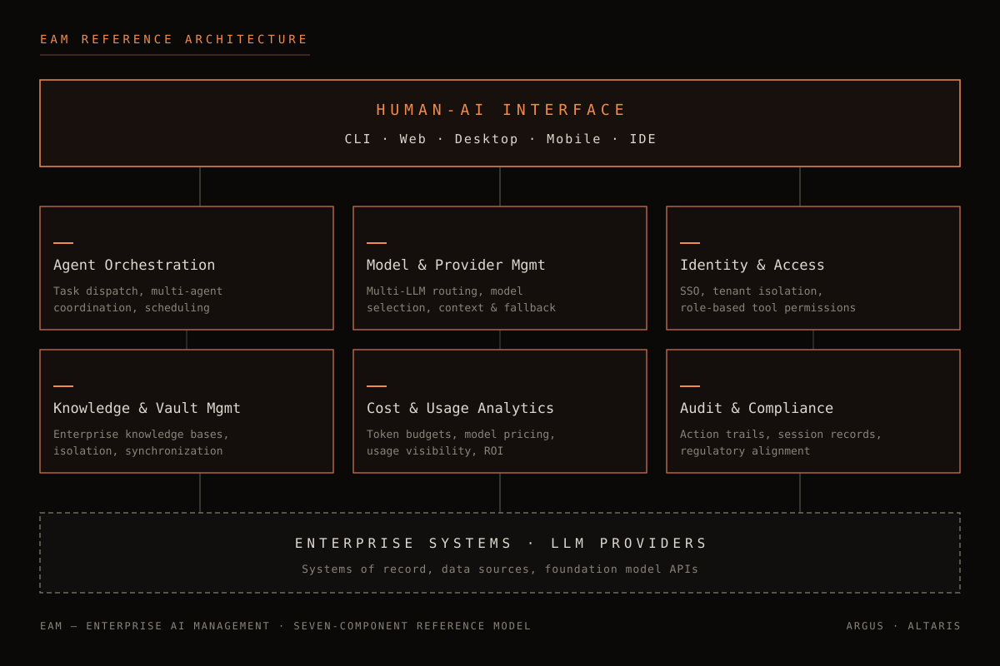
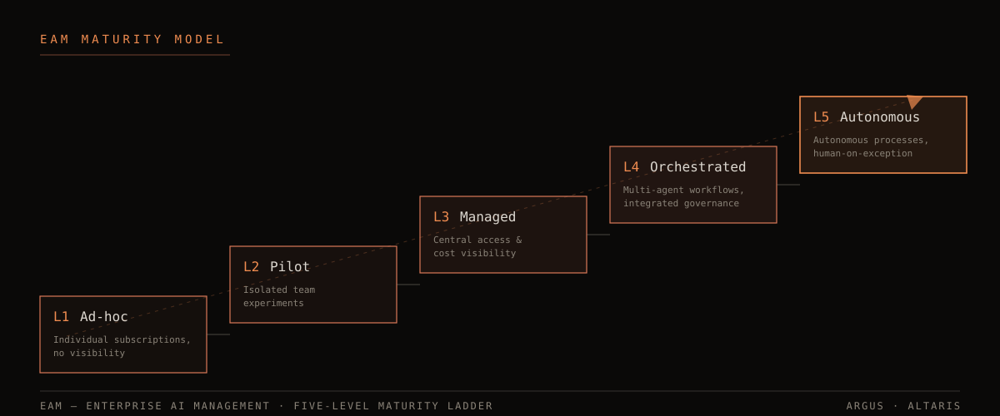

# Kurumsal Yapay Zeka Yönetimi (EAM): Kurumların Eksik Yapay Zeka Katmanı

*Bir kategori tanımı ve referans mimari — Haziran 2026, v1.0*

**Yazar:** Burak Demirsoy · Argus Teknoloji A.Ş.

---

## 1. Yönetici Özeti

Kurumsal yazılım tarihi, dağınık olanın merkezileştirilmesi tarihidir. Üretim planlaması MRP ile, kurumsal kaynaklar ERP ile, müşteri ilişkileri CRM ile tek bir yönetim katmanına kavuştu. Bugün kurumların karşısında aynı örüntünün yeni bir örneği duruyor: yapay zeka, kurumun her köşesine hızla yayılıyor — ancak onu planlayan, yöneten ve denetleyen bir katman henüz yok.

Bu doküman, bu boşluğu dolduran kurumsal yazılım disiplinini tanımlar:

> **Enterprise AI Management (EAM):** Bir kurumun yapay zeka varlıklarını — agent'lar, modeller, sağlayıcılar, bilgi tabanları, erişim hakları ve maliyetler — tek bir yönetim katmanında planlayan, yöneten ve denetleyen kurumsal yazılım disiplini.

Tek cümleyle: **ERP kaynaklarınızı, CRM müşteri ilişkilerinizi yönetir; EAM yapay zekanızı yönetir.**

EAM bir ürün kategorisi olduğu kadar bir yönetim disiplinidir. Bir kurumun EAM olgunluğu, yapay zekadan elde ettiği değerin sürdürülebilirliğini belirler. Yapay zekayı bireysel araçlar düzeyinde tüketen kurumlar kısa vadeli verimlilik kazanımları elde edebilir; ancak görünürlük, güvenlik, maliyet kontrolü ve denetlenebilirlik olmadan bu kazanımlar ölçeklenemez — çoğu zaman ölçüldükçe kaybolur.

Bu whitepaper üç şey yapar:

1. **Problemi adlandırır.** Kontrolsüz yapay zeka yayılımını ("AI sprawl") ve onun kurumsal maliyetlerini, güncel sektör verileriyle ortaya koyar.
2. **Kategoriyi tanımlar.** EAM'in ne olduğunu, ne olmadığını ve yedi bileşenli referans mimarisini tarif eder.
3. **Bir yol haritası sunar.** Beş seviyeli EAM Olgunluk Modeli ile kurumların kendilerini konumlandırmasını ve sonraki adımı görmesini sağlar.

Doküman vendor-neutral bir kategori tanımı olarak yazılmıştır. Son bölümde, referans mimarinin uygulanabilirliğini göstermek amacıyla somut bir implementasyon örneği olarak Altaris platformu ele alınmaktadır.

---

## 2. Problem: AI Sprawl

### 2.1 Yayılma, planlamadan önce geldi

Kurumlarda yapay zeka benimsemesi, kurumsal yazılım tarihindeki hiçbir teknolojiye benzemeyen bir hızla gerçekleşti. ERP projeleri yıllarca süren planlama döngüleriyle, üst yönetim kararlarıyla ve danışmanlık ordularıyla geldi. Yapay zeka ise tam tersi bir yol izledi: tabandan, bireysel aboneliklerle, çoğu zaman BT departmanının haberi bile olmadan kurumun içine sızdı.

Bugün tipik bir orta-büyük ölçekli kurumda şu tablo olağandır:

- Pazarlama ekibi bir içerik üretim aracına abone olmuştur.
- Yazılım ekibi iki farklı kod asistanı kullanmaktadır; bazı geliştiriciler kişisel hesaplarıyla üçüncüsünü denemektedir.
- Finans departmanındaki bir uzman, aylık raporları herkese açık bir sohbet botuna yapıştırarak özetletmektedir.
- Satış ekibi, müşteri görüşme kayıtlarını bir transkripsiyon servisine yüklemektedir.
- Birkaç ekip, düşük kodlu araçlarla kendi otonom agent'larını kurmuş ve bunları üretim verisine bağlamıştır.

Bu tablonun her bir satırı, tekil olarak bakıldığında bir verimlilik kazanımıdır. Toplamına bakıldığında ise yönetilmeyen bir riskin ve ölçülemeyen bir harcamanın fotoğrafıdır. Bu duruma **AI sprawl** — kontrolsüz yapay zeka yayılımı — diyoruz.

### 2.2 Rakamlarla görünüm

AI sprawl bir azınlık problemi değildir; sektör verileri yayılmanın hem hızını hem de yönetim açığını doğrulamaktadır:

- Gartner, **2026 sonunda kurumsal uygulamaların %40'ının görev-spesifik AI agent'ları içereceğini** öngörmektedir — bu oran 2025'te %5'in altındaydı.¹ Tek bir yılda sekiz katlık bir artış, hiçbir kurumsal yönetişim modelinin organik olarak yetişemeyeceği bir tempodur.
- 2026 itibarıyla **Fortune 500 şirketlerinin %80'i düşük kodlu/kodsuz araçlarla kurulmuş aktif AI agent'ları çalıştırmaktadır; ancak bu kurulumların büyük çoğunluğunda birleşik bir yönetişim katmanı bulunmamaktadır.**² Agent'lar vardır; onları gören, sınırlayan ve denetleyen yapı yoktur.
- Aynı dönemde **CIO'ların %71'i, 2026 ortasına kadar yapay zeka yatırımlarının değerini kanıtlama baskısı altındadır** — aksi halde bütçe kesintileriyle karşı karşıyadır.² Değer kanıtlamanın ön koşulu ölçümdür; ölçümün ön koşulu ise merkezi görünürlüktür. AI sprawl ortamında ikisi de mümkün değildir.

Bu üç veri birlikte okunduğunda problem netleşir: **benimseme hızı, yönetim kapasitesinin çok önündedir ve fatura yaklaşmaktadır.**

### 2.3 AI sprawl'un beş maliyeti

**1. Shadow AI — görünmeyen kullanım.** Çalışanların kişisel hesaplarla veya departman kartlarıyla edindiği yapay zeka araçları, BT envanterinde görünmez. Görünmeyen araç, veri politikasına tabi tutulamaz. Kurumun en hassas verileri — sözleşmeler, müşteri kayıtları, kaynak kod — kurumun hiç sözleşme imzalamadığı sağlayıcıların sunucularına akabilir.

**2. Yönetişim boşluğu.** Bir agent'a hangi sistemlere erişim verildiğini, hangi eylemleri otonom olarak yapabildiğini ve dün gece saat üçte ne yaptığını kimse söyleyemiyorsa, o kurum agent çalıştırmıyor demektir; agent'a katlanıyor demektir. Regülasyona tabi sektörlerde (finans, sağlık, kamu) bu boşluk yalnızca operasyonel değil, hukuki bir risktir.

**3. Mükerrer harcama ve ölçülemeyen maliyet.** Aynı yetenek için üç ayrı abonelik, kullanılmayan koltuklar, departman kartlarına dağılmış faturalar: AI sprawl ortamında kurum, yapay zekaya toplam ne kadar harcadığını çoğu zaman yaklaşık olarak bile söyleyemez. Token bazlı fiyatlandırma modelleri, geleneksel yazılım bütçeleme alışkanlıklarıyla yönetilemez.

**4. Kanıtlanamayan ROI.** Harcama ölçülemiyorsa, getiri hiç ölçülemez. CIO'ların %71'inin üzerindeki değer-kanıtlama baskısının² karşısında, dağınık kullanım yapısal olarak savunmasızdır: hangi ekibin, hangi iş sürecinde, hangi modelle, ne kadar maliyetle, ne kazandığı sorusunun cevabı sistemde yoktur.

**5. Kilitlenme ve kırılganlık.** Tek bir sağlayıcıya organik olarak bağımlı hale gelen kurum, fiyat değişikliklerine, hizmet kesintilerine ve model davranış değişikliklerine karşı pazarlık gücünü kaybeder. Sağlayıcı çeşitliliği bir strateji olarak değil, ancak bir yönetim katmanı üzerinden uygulanabilir.

### 2.4 Yaygın ama yanlış cevaplar

AI sprawl ile yüzleşen kurumların verdiği ilk tepkiler genellikle üç kalıptan birine girer — ve üçü de problemi çözmek yerine biçim değiştirir:

**Yasaklama.** "Kurum içinde yapay zeka aracı kullanımı yasaktır" politikası, kâğıt üzerinde riski sıfırlar; pratikte ise kullanımı görünmez kılar. Çalışanlar verimlilik kazandıran araçları bırakmaz; kişisel telefonlarına ve kişisel hesaplarına taşır. Yasak sonrası kurumda yapay zeka kullanımı azalmaz — yalnızca ölçülemez ve yönetilemez hale gelir. Shadow AI, çoğu zaman bir yasağın gölgesinde büyür.

**Tek sağlayıcı fermanı.** "Yalnızca X aracını kullanacağız" kararı, envanter problemini kısmen çözer ama iki yeni problem yaratır: kurum, tek sağlayıcının fiyatlamasına ve yol haritasına kilitlenir; ve hiçbir tek araç her iş yükü için en iyisi olmadığından, fermana rağmen kenarlarda alternatif kullanım yeniden filizlenir. Tek sağlayıcı kararı bir yönetim katmanı değildir; yönetim katmanı ihtiyacının ertelenmesidir.

**Politika dokümanı yazıp bırakmak.** "Yapay Zeka Kullanım Politikası" yayımlamak gerekli bir adımdır; ancak politikayı uygulayan teknik katman yoksa, doküman bir niyet beyanı olarak kalır. Hangi verinin hangi modele gidebileceğini bir PDF değil, erişim mimarisi belirler. Uygulanamayan politika, denetimde kuruma koruma değil, "biliyordunuz ve önlemediniz" yükümlülüğü üretir.

Bu üç tepkinin ortak hatası aynıdır: **davranışı değiştirmeye çalışırken altyapıyı değiştirmemek.** Çalışanlara güvenli, yetkilendirilmiş, kurumsal bilgiye bağlı ve gölge alternatiflerden daha yetenekli bir yapay zeka katmanı sunulmadıkça, hiçbir yasak ve hiçbir politika dokümanı sprawl'u durduramaz.

### 2.5 Bu bir araç sorunu değildir

Kritik tespit şudur: AI sprawl, yanlış araçların seçilmesinden kaynaklanmaz. Tek tek bakıldığında araçların çoğu iyidir; sorun, onları kurumsal bir bütün halinde yönetecek katmanın yokluğudur. Daha iyi bir sohbet botu, daha güçlü bir model veya daha yetenekli bir agent, yönetim katmanı boşluğunu çözmez — çoğu zaman derinleştirir.

Kurumsal yazılım tarihi bu durumu daha önce görmüştür. Çözümün ne olduğunu da göstermiştir.

---

## 3. Tarihsel Paralel: MRP'den ERP'ye

### 3.1 1990'ların ada-yazılım krizi

1970'ler ve 80'lerde üretim yapan kurumlar, malzeme ihtiyaç planlaması için MRP (Material Requirements Planning) sistemlerini benimsedi. MRP işe yaradı — ama yalnızca kendi adasında. Finans kendi muhasebe paketini, insan kaynakları kendi bordro sistemini, satış kendi sipariş defterini tutuyordu. Her sistem kendi verisine sahipti; hiçbiri diğerini görmüyordu.

Sonuç bugünden bakınca tanıdıktır: aynı verinin dört ayrı kopyası, birbiriyle çelişen raporlar, departmanlar arasında elle taşınan çıktılar ve "kurumun bütününü kimse görmüyor" şikâyeti. 1990'larda bu krizin cevabı ERP oldu: kurumun tüm kaynaklarını — malzeme, para, insan, üretim kapasitesi — **tek bir entegre yönetim katmanında** birleştiren sistemler. ERP'nin devrimi herhangi bir modülünün üstünlüğü değildi; devrim, **bütünleşik tek katman** fikrinin kendisiydi.

### 3.2 Aynı film, yeni teknoloji

2026'nın yapay zeka manzarası, yapısal olarak ERP öncesi dönemin tekrarıdır. Departmanlar kendi araçlarını seçmekte, kendi verilerini beslemekte ve kendi adalarında çalışmaktadır. Eşleştirme tablosu kendisi için konuşur:

| 1990'lar — Kaynak yönetimi sorunu | 2026 — Yapay zeka yönetimi sorunu |
|---|---|
| Her departmanın kendi ada-yazılımı (muhasebe, bordro, MRP) | Her departmanın kendi AI aboneliği ve agent kurulumu |
| Aynı verinin çelişen kopyaları | Aynı kurumsal bilginin farklı araçlara dağılmış, senkronize olmayan kopyaları |
| Departmanlar arası elle veri taşıma | Sohbet botlarına elle veri yapıştırma, çıktıları elle taşıma |
| Toplam maliyeti kimse bilmiyor | AI harcamasını ve token tüketimini kimse bilmiyor |
| Süreçler denetlenemiyor, izlenemiyor | Agent eylemleri kayıtsız, denetlenemiyor |
| Çözüm: kaynakları tek katmanda birleştiren **ERP** | Çözüm: yapay zekayı tek katmanda birleştiren **EAM** |

### 3.3 Paralelin sınırları

Hiçbir tarihsel analoji birebir değildir; farkları görmek, analojiyi güçlendirir. İki fark öne çıkar:

**Hız.** ERP benimsemesi on yıllara yayıldı; kurumların öğrenmek, hata yapmak ve düzeltmek için zamanı oldu. Yapay zeka benimsemesi — Bölüm 2'deki veriler ortadadır — aynı dönüşümü yıllar değil çeyrekler ölçeğinde dayatmaktadır. Bu, EAM kararının ertelenme maliyetini ERP dönemindekinden çok daha yüksek kılar.

**Aktörlük.** ERP'nin yönettiği kaynaklar pasiftir: stok karar vermez, nakit eyleme geçmez. EAM'in yönettiği varlıkların bir bölümü ise **otonom aktörlerdir** — agent'lar muhakeme yapar, araç kullanır, sistemlere yazar. Bu, EAM'e ERP'de bulunmayan iki sorumluluk ekler: eylem sınırlarının politika düzeyinde tanımlanması ve her otonom eylemin denetlenebilir kılınması. Başka deyişle EAM, ERP'nin envanter disiplinine, bir *iş gücü yönetimi* disiplinini ekler.

### 3.4 Tarihin dersi

ERP dalgasından çıkarılacak üç ders, EAM için doğrudan geçerlidir:

1. **Kazanan, en iyi modülü yapan değil, katmanı kuran oldu.** 1990'larda en iyi muhasebe paketini yapan firmalar değil, entegre katmanı tanımlayan firmalar kurumsal yazılımın merkezine oturdu. Yapay zekada da kalıcı değer, tekil modellerde değil, onları yöneten katmanda birikecektir.
2. **Erken davranan kurumlar bileşik avantaj elde etti.** ERP'yi erken ve doğru kuran kurumlar, sonraki her teknolojik dalgayı (e-ticaret, tedarik zinciri entegrasyonu, analitik) daha düşük maliyetle yakaladı. EAM'i erken kuran kurumlar, her yeni model neslini ve agent yeteneğini marjinal maliyetle devreye alacaktır.
3. **Geçiş, teknoloji projesinden çok yönetim kararıdır.** ERP projelerinin başarısı yazılımdan çok kurumsal sahiplenmeye bağlıydı. EAM de aynıdır: bir araç satın alma kararı değil, yapay zekayı kurumsal bir varlık sınıfı olarak yönetme kararıdır.

---

## 4. EAM'in Tanımı ve Sınırları

### 4.1 Formel tanım

> **Enterprise AI Management (EAM):** Bir kurumun yapay zeka varlıklarını — agent'lar, modeller, sağlayıcılar, bilgi tabanları, erişim hakları ve maliyetler — tek bir yönetim katmanında planlayan, yöneten ve denetleyen kurumsal yazılım disiplini.

Tanımın üç fiili bilinçli seçilmiştir:

- **Planlamak:** Hangi iş süreçlerinde hangi yapay zeka yeteneklerinin, hangi modellerle ve hangi bütçeyle kullanılacağına dair kurumsal kararların verilmesi. ERP'deki "planning" ile aynı anlam ağırlığını taşır.
- **Yönetmek:** Agent'ların, model erişimlerinin, bilgi tabanlarının ve kullanıcı haklarının yaşam döngüsü boyunca işletilmesi — devreye alma, güncelleme, sınırlama, devreden çıkarma.
- **Denetlemek:** Her yapay zeka eyleminin kim/ne/ne zaman/hangi veriyle sorularına cevap verecek şekilde kayıt altına alınması ve bu kayıtların iç denetim ile regülasyon gereksinimlerine sunulabilmesi.

Tanımdaki "yapay zeka varlıkları" ifadesi de kasıtlıdır: EAM, yapay zekayı bir araç değil, **yönetilmesi gereken bir kurumsal varlık sınıfı** olarak ele alır — tıpkı ERP'nin makineyi, stoku ve nakdi varlık olarak ele alması gibi.

### 4.2 EAM ne değildir

Kategori tanımlarının en az tanım kadar önemli kısmı sınırlardır. EAM aşağıdakilerin hiçbiri değildir:

**EAM bir chatbot veya asistan ürünü değildir.** Sohbet arayüzü, EAM mimarisinde yalnızca bir erişim kanalıdır (bkz. Bölüm 5.7). Bir kuruma sohbet botu vermek, ona EAM vermek değildir; tıpkı bir muhasebe ekranı vermenin ERP vermek olmadığı gibi.

**EAM bir model aboneliği değildir.** Tek bir sağlayıcının modellerine kurumsal erişim satın almak, model katmanını çözer; yönetim katmanını çözmez. Hangi modelin nerede kullanıldığı, ne tükettiği ve ne ürettiği soruları abonelikle cevaplanmaz. EAM tanım gereği **çok modelli ve çok sağlayıcılıdır.**

**EAM, MLOps değildir.** MLOps, modellerin *eğitilmesi, sürümlenmesi ve servis edilmesi* disiplinidir — model **üretimi** tarafındadır. EAM ise modellerin kurum içinde *tüketilmesinin* yönetimidir: kim, hangi işte, hangi maliyetle, hangi yetkilerle. Bir kurum hiç model eğitmeden ileri düzey EAM olgunluğuna ulaşabilir; tersine, güçlü MLOps'a sahip bir kurum EAM açısından tamamen olgunlaşmamış olabilir. İki disiplin tamamlayıcıdır, örtüşmez.

**EAM, RPA değildir.** Robotik süreç otomasyonu, deterministik kuralların betiklenmesidir. EAM'in yönettiği agent'lar olasılıksal sistemlerdir: muhakeme yapar, araç seçer, beklenmedik durumlarla karşılaşır. Deterministik otomasyonun yönetim ihtiyaçları (sürüm kontrolü, istisna kuyruğu) ile olasılıksal otomasyonun yönetim ihtiyaçları (izin sınırları, eylem denetimi, insan onay kapıları) kategorik olarak farklıdır.

### 4.3 Kısaltma üzerine not

*EAM kısaltması, kurumsal yazılım literatüründe Enterprise Asset Management (fiziksel varlık yönetimi) için de kullanılmaktadır. İki disiplin farklı problem alanlarına aittir ve bağlam içinde karışma riski düşüktür; bu doküman boyunca EAM, yalnızca Enterprise AI Management anlamında kullanılmıştır. Kavramsal akrabalık ise dikkat çekicidir: her iki disiplin de kurumsal varlıkların envanterini, yaşam döngüsünü ve maliyetini yönetir — biri fiziksel varlıkların, diğeri yapay zeka varlıklarının.*

---

## 5. EAM Referans Mimarisi

EAM, yedi bileşenden oluşan bir referans mimariyle tarif edilebilir. Bileşenler ayrı ürünler değil, tek bir yönetim katmanının görev alanlarıdır; aralarındaki entegrasyon, mimarinin kendisi kadar önemlidir.

### 5.1 Agent Orchestration

Agent'lar, EAM'in yönettiği temel iş gücü birimidir. Agent Orchestration bileşeni; görevlerin agent'lara dağıtılmasını, birden fazla agent'ın aynı iş üzerinde koordineli çalışmasını, zamanlanmış ve tekrarlayan görevlerin işletilmesini ve agent'lar arası iş kuyruklarının yönetilmesini kapsar.

Olgun bir orchestration katmanı şu soruları cevaplayabilir: Şu anda kaç agent, hangi görevlerde çalışıyor? Bir görev başarısız olursa ne olur — kim devralır, kim haberdar edilir? Uzun süren bir iş, insan onayı gerektiren bir noktaya geldiğinde nasıl duraklatılır? Paralel çalışan agent'lar aynı kaynağa yazmaya çalışırsa çakışma nasıl çözülür?

Orchestration ayrıca **insan-döngüde (human-in-the-loop)** tasarımın uygulandığı yerdir: hangi eylemlerin otonom yapılabileceği, hangilerinin onay kapısından geçeceği burada tanımlanır.

*Olmadığında ne olur:* Agent'lar bireysel araçlar olarak kalır. Her çalışan kendi agent'ını kendi yöntemiyle çalıştırır; kurumsal süreçlere bağlanan, devir teslim edilebilen, izlenebilen bir yapay zeka iş gücü oluşmaz. Otomasyon, onu kuran kişiyle birlikte kurumdan ayrılır.

### 5.2 Model & Provider Management

Hiçbir model her işte en iyi değildir ve hiçbir sağlayıcı sonsuza dek en uygun seçenek kalmaz. Model & Provider Management bileşeni; kurumun erişebildiği tüm modellerin ve sağlayıcıların tek envanterde tutulmasını, iş yüküne göre model seçimini, bağlam penceresi ve yetenek farklarının yönetilmesini ve bir sağlayıcı kesintisinde alternatife geçiş (fallback) mekanizmalarını kapsar.

Bu bileşenin stratejik değeri pazarlık gücüdür: modeller arasında geçiş maliyeti düşük olan kurum, fiyat değişikliklerine ve hizmet koşullarına karşı korunaklıdır. Operasyonel değeri ise doğru eşleştirmedir — basit sınıflandırma işine en pahalı modeli, hassas muhakeme işine en zayıf modeli atayan kurum, iki yönde de kaybeder.

Yerel ve şirket-içi (on-premises) modellerin yönetimi de bu bileşene aittir: veri sınırlarını terk edemeyecek iş yükleri için yerel model çalıştırma, EAM katmanının aynı envanter ve aynı erişim kuralları içinde sunabilmesi gereken bir seçenektir.

*Olmadığında ne olur:* Kurum, tek sağlayıcıya organik bağımlılık geliştirir. Model seçimi bireysel alışkanlıkla yapılır; pahalı modeller önemsiz işlerde tüketilir. Sağlayıcı kesintisi, kurumsal iş akışlarının kesintisine dönüşür.

### 5.3 Identity & Access

Yapay zeka katmanı, kurumun kimlik altyapısından ayrı bir kimlik adası olamaz. Identity & Access bileşeni; kullanıcıların kurumsal kimlik sistemiyle (tek oturum açma) doğrulanmasını, çok kiracılı yapılarda kiracı (tenant) verilerinin birbirinden mutlak izolasyonunu, rol bazlı yetkilendirmeyi ve **araç-düzeyi izinleri** — hangi kullanıcının veya agent'ın hangi araçları, hangi sistemler üzerinde kullanabileceğini — kapsar.

Agent'lar bu bileşende özel bir dikkat gerektirir: bir agent, onu çalıştıran kullanıcının yetkileriyle mi, kendi servis kimliğiyle mi hareket eder? Bir agent'a verilen dosya sistemi erişimi, komut çalıştırma hakkı veya dış servis bağlantısı nerede tanımlanır ve nerede kısıtlanır? EAM'de bu soruların cevabı politika düzeyindedir, agent'ın kendi yapılandırmasına bırakılmaz.

*Olmadığında ne olur:* Erişim, paylaşılan API anahtarları ve kişisel hesaplarla yürür. Ayrılan çalışanın erişimi kapatılamaz, çünkü hangi anahtarların kimde olduğu bilinmez. Bir agent'ın yetki sınırı, onu kuran kişinin o günkü dikkatine bağlıdır.

### 5.4 Knowledge & Vault Management

Yapay zekanın kurumsal değeri, kurumun kendi bilgisine erişimiyle orantılıdır; riski de aynı erişimle orantılıdır. Knowledge & Vault Management bileşeni; kurumsal bilgi tabanlarının (dokümanlar, prosedürler, kurum hafızası) yapay zekaya kontrollü sunulmasını, bilgi alanlarının birbirinden izolasyonunu (satış bilgisi ile İK bilgisinin aynı havuzda erimemesi), bilgi tabanlarının güncel tutulması için senkronizasyon mekanizmalarını ve hangi agent'ın hangi bilgi alanına erişebileceğinin tanımlanmasını kapsar.

Buradaki kritik tasarım ilkesi **bölmelendirmedir:** kurumsal bilgi, tek bir genel havuz değil, erişim sınırları tanımlı kasalar (vault) halinde yönetilir. Bir müşteri destek agent'ının ürün dokümantasyonuna erişmesi gerekir; maaş verilerine erişmesi gerekmez. Bu ayrım, bilgi katmanının mimarisinde kurulmadıysa, hiçbir talimat metni onu güvenilir şekilde ikame edemez.

*Olmadığında ne olur:* Çalışanlar kurumsal bilgiyi sohbet pencerelerine elle yapıştırır — bilgi, kurumun kontrolünden o anda çıkar. Ya da tersi olur: yapay zeka kuruma dair hiçbir şey bilmez ve üretilen çıktılar jenerik kalır. İki uç da değer kaybıdır.

### 5.5 Cost & Usage Analytics

Token bazlı fiyatlandırma, kurumsal bütçeleme alışkanlıklarını kıran bir modeldir: maliyet, koltuk sayısıyla değil kullanım yoğunluğuyla büyür ve önceden kestirilmesi zordur. Cost & Usage Analytics bileşeni; tüm model çağrılarının tüketim kayıtlarını, kullanıcı/ekip/iş-süreci bazında maliyet dağılımını, model bazlı fiyatlandırma tanımlarını, bütçe eşikleri ve uyarıları ile yöneticilere sunulan kullanım panellerini kapsar.

Bu bileşen, Bölüm 2'de tarif edilen ROI-kanıtlama baskısının doğrudan cevabıdır. "Yapay zeka bize ne kazandırıyor?" sorusu ancak "neye, ne harcıyoruz?" sorusu cevaplanabildiğinde anlamlıdır. Kullanım verisi ayrıca optimizasyonun ham maddesidir: hangi iş yükünün daha ekonomik bir modele taşınabileceği, hangi ekibin eğitime ihtiyaç duyduğu, hangi otomasyonun beklenen verimi üretmediği bu veriden okunur.

*Olmadığında ne olur:* Yapay zeka harcaması, departman kartlarına dağılmış, toplamı bilinmeyen bir kalem olur. Bütçe görüşmesinde CIO'nun elinde anekdot vardır, veri yoktur. Maliyet sürprizleri, genellikle en kötü zamanda gelir.

### 5.6 Audit & Compliance

Olasılıksal sistemlerin kurumsal kullanımında denetlenebilirlik, lüks değil ön koşuldur. Audit & Compliance bileşeni; her yapay zeka eyleminin (kim, hangi agent, hangi araçla, hangi veri üzerinde, ne zaman) değiştirilemez kayıtlarını, oturum kayıtlarının saklanmasını ve aranabilirliğini, regülasyon gereksinimlerine (sektörel mevzuat, veri koruma rejimleri) uyumun raporlanabilmesini ve olay sonrası incelemeler için iz sürülebilirliği kapsar.

Denetim katmanının testi basittir: *"Geçen salı gecesi 03:14'te üretim veritabanına bağlanan agent neydi, kim adına çalışıyordu, ne yaptı?"* sorusuna dakikalar içinde, kayıtlara dayanarak cevap verilebiliyor mu? Verilemiyorsa, kurum otonom sistemler çalıştırmanın risklerini taşıyor ama yönetmiyor demektir.

Regülasyona tabi sektörlerde bu bileşen, yapay zeka kullanımının önündeki asıl kilidi açar: denetlenebilirlik garanti edilemeyen hiçbir otomasyon, uyum biriminden geçemez — geçmemelidir.

*Olmadığında ne olur:* Bir veri sızıntısı veya hatalı otonom eylem sonrasında kurum, ne olduğunu yeniden kuramaz. Regülatör sorularına "bilmiyoruz" cevabı verilir. Hukuki sorumluluk, kayıt yokluğunda en ağır yorumla dağıtılır.

### 5.7 Human-AI Interface

Yapay zeka katmanının değeri, ona erişilebildiği ölçüde gerçekleşir. Human-AI Interface bileşeni; teknik kullanıcılar için komut satırı erişimini, operasyonel kullanıcılar için web panellerini, masaüstü ve mobil istemcileri, geliştirme ortamı (IDE) entegrasyonlarını ve eller-serbest senaryolar için sesli etkileşimi kapsar. Uzaktaki bir oturumu izleme ve devralma (remote control) gibi gözetim arayüzleri de bu bileşene aittir.

Buradaki mimari ilke şudur: **kanallar çoğalır, yönetim katmanı tekildir.** Kullanıcı ister telefonundan ister terminalinden bağlansın; kimliği aynı yerden doğrulanır, yetkileri aynı politikadan okunur, eylemleri aynı denetim iziyle kaydedilir, tüketimi aynı analitiğe işlenir. Arayüz çeşitliliği, yönetim tekilliğinden taviz vermeden sağlanır.

*Olmadığında ne olur:* Yapay zeka, yalnızca tek bir arayüzü kullanabilen çalışan profiline sıkışır. Sahadaki yönetici, üretim hattındaki mühendis, yoldaki satışçı katmanın dışında kalır — ve dışarıda kaldıkları her saat, gölge araçlara dönme gerekçesidir.

### 5.8 Bütünün kuralı

Yedi bileşenin her biri tek başına edinilebilir ürünlere benzeyebilir; piyasada her birinin nokta çözümü vardır. EAM'i kategori yapan, bileşenlerin **aynı kimlik, aynı politika ve aynı denetim izi üzerinde** çalışmasıdır. Orchestration'ın başlattığı görev, Identity'nin tanıdığı kullanıcıya, Vault'un sınırladığı bilgiyle, Cost'un ölçtüğü tüketimle, Audit'in kaydettiği izle yürür. Bu bütünlük parçalandığında geriye EAM değil, yeni bir ada-yazılım koleksiyonu kalır — yani çözmeye geldiğimiz problemin kendisi.

---

## 6. EAM Olgunluk Modeli

Kurumlar EAM'e sıfırdan başlamaz; her kurum, çoğu zaman farkında olmadan, bir olgunluk seviyesinin içindedir. Aşağıdaki beş seviyeli model, mevcut durumu adlandırmak ve sonraki adımı görünür kılmak için tasarlanmıştır.

### Seviye 1 — Ad-hoc

Yapay zeka kullanımı bireysel inisiyatifle yürür. Tanı kriterleri:

- Çalışanlar kişisel veya departman hesaplarıyla araçlara abonedir; merkezi envanter yoktur.
- BT ve güvenlik birimleri, kullanılan araçların tam listesini veremez.
- Kurumsal veri, kişisel hesaplar üzerinden dış servislere akabilmektedir.
- Toplam yapay zeka harcaması bilinmemektedir.

### Seviye 2 — Pilot

Kurum, yapay zekayı resmi olarak denemektedir. Tanı kriterleri:

- Seçili ekiplerde, tanımlı kapsamla pilot projeler yürümektedir.
- En az bir kurumsal sözleşme/abonelik mevcuttur; ancak kapsam dışı bireysel kullanım sürmektedir.
- Pilotlar birbirinden izoledir; öğrenimler kurumsallaşmamaktadır.
- Başarı ölçütleri proje bazlıdır, kurumsal bir ölçüm çerçevesi yoktur.

### Seviye 3 — Managed

Yapay zeka erişimi merkezileşmiştir. Tanı kriterleri:

- Kullanıcılar kurumsal kimlikle (tek oturum açma) doğrulanır; erişim rollerle yönetilir.
- Model ve sağlayıcı envanteri tek noktadan yönetilir; onaylı araç listesi vardır ve uygulanır.
- Kullanım ve maliyet, kullanıcı/ekip bazında raporlanabilir.
- Temel denetim kayıtları tutulmaktadır.

### Seviye 4 — Orchestrated

Yapay zeka, bireysel kullanımdan kurumsal iş akışına geçmiştir. Tanı kriterleri:

- Çok adımlı iş süreçleri, koordineli agent'larla yürütülmektedir; zamanlanmış görevler üretimdedir.
- İnsan onay kapıları politika olarak tanımlıdır; hangi eylemin otonom olduğu yazılıdır.
- Bilgi tabanları bölmelendirilmiş, agent-bilgi erişim eşlemesi tanımlanmıştır.
- Yönetişim (izinler, denetim, maliyet) iş akışlarına gömülüdür; sonradan eklenmez.

### Seviye 5 — Autonomous

Yapay zeka, denetimli özerklikle uçtan uca süreçler işletmektedir. Tanı kriterleri:

- Tanımlı süreçler, istisna durumları dışında insan müdahalesi olmadan tamamlanmaktadır.
- İstisna yönetimi tasarlanmıştır: agent, sınırına geldiğinde işi tanımlı insana devreder.
- Model/sağlayıcı seçimi, maliyet-performans verisine göre dinamik olarak optimize edilmektedir.
- Yapay zeka kapasitesi, kurumsal planlamada bir üretim faktörü olarak bütçelenmektedir.

### 6.1 Özdeğerlendirme

Aşağıdaki tabloda her satır için kurumunuzu en iyi anlatan sütunu işaretleyin; ağırlıklı görünüm, seviyenizi verir.

| Boyut | Seviye 1-2 işareti | Seviye 3 işareti | Seviye 4-5 işareti |
|---|---|---|---|
| **Envanter** | Kullanılan araçların tam listesi yok | Onaylı araç/model envanteri var | Envanter + iş yükü-model eşlemesi optimize ediliyor |
| **Kimlik** | Kişisel hesaplar, paylaşılan anahtarlar | Kurumsal kimlik + rol bazlı erişim | Agent'lar dahil tüm aktörler politika altında |
| **Maliyet** | Toplam harcama bilinmiyor | Ekip bazında raporlanıyor | Bütçe eşikleri + süreç bazlı ROI ölçümü |
| **Denetim** | Kayıt yok | Temel eylem kayıtları | Değiştirilemez iz + uyum raporlaması |
| **Otomasyon** | Bireysel sohbet kullanımı | Tekil görevlerde agent kullanımı | Koordineli çok-agent'lı süreçler |
| **Bilgi** | Elle kopyala-yapıştır | Merkezi bilgi tabanı | Bölmelendirilmiş kasalar + erişim eşlemesi |

Modelin amacı sıralama değil, yön duygusudur: her seviye, bir sonrakinin ön koşullarını üretir. Seviye 3'ü (merkezi yönetim) kurmadan Seviye 4'e (orkestrasyon) sıçramaya çalışan kurumlar, genellikle yönetilmeyen otomasyonu ölçeklendirir — yani riski otomatikleştirir.

### 6.2 Geçiş ilkeleri

Seviyeler arası geçişte üç ilke, EAM dönüşümünü tipik bir BT projesinden ayırır:

**1. Önce görünürlük, sonra kontrol, sonra otomasyon.** Doğru sıra budur ve atlanamaz. Ne kullanıldığını görmeden (envanter) kural koyamazsınız; kural koymadan (kimlik, izinler, bütçe) otomasyonu güvenle büyütemezsiniz. Seviye 1'den 3'e giden yol görünürlük ve kontrol inşasıdır; 3'ten 5'e giden yol bu temelin üzerinde otomasyonun derinleşmesidir.

**2. Gölgeyle rekabet et, gölgeyi yasaklama.** Merkezi katmana geçişin en güvenilir ölçüsü, gölge kullanımın kendiliğinden sönmesidir. Bu ancak kurumsal katman, gölge alternatiflerden *daha iyi* olduğunda gerçekleşir: daha yetenekli modeller, kurumsal bilgiye gerçek erişim, daha az sürtünme. Bölüm 2.4'teki yasaklama refleksinin tersine, başarılı EAM dönüşümleri çalışana bir şey *verir* — elinden almaz.

**3. Olgunluk homojen olmak zorunda değildir.** Kurumun tamamının aynı seviyede olması gerekmez; yazılım ekibi Seviye 4'te koordineli agent'lar çalıştırırken, başka birimler Seviye 3'ün merkezi erişimini kullanıyor olabilir. Önemli olan, tüm seviyelerin **aynı yönetim katmanının üzerinde** durmasıdır — böylece bir birimin öğrendiği orkestrasyon kalıbı, diğer birimlere platform değişikliği olmadan taşınır.

---

## 7. Altaris: Bir EAM İmplementasyonu

Bu bölüm, Bölüm 5'teki referans mimarinin pratikte kurulabilir olduğunu göstermek amacıyla, Argus Teknoloji'nin Altaris platformunu bir EAM implementasyonu olarak inceler. Amaç ürün tanıtımı değil, mimari-ürün eşlemesinin somutlanmasıdır; aynı eşleme, referans mimariyi karşılayan başka platformlar için de yapılabilir.

### 7.1 Bileşen eşlemesi

| EAM Bileşeni | Altaris karşılığı |
|---|---|
| **Agent Orchestration** | Görev dağıtımı yapan agent dispatch sistemi; paralel ve arka planda çalışan agent'lar; zamanlanmış görevler; uzun işlerde insan onay noktaları |
| **Model & Provider Management** | Çok sağlayıcılı model envanteri (bulut ve yerel modeller dahil); oturum ve görev bazında model seçimi; sağlayıcı/model bazında bağlam penceresi yönetimi |
| **Identity & Access** | Kurumsal tek oturum açma; kiracı (tenant) düzeyinde veri izolasyonu; rol bazlı yetkiler; kullanıcı ve agent düzeyinde araç-izin kısıtları |
| **Knowledge & Vault Management** | Bölmelendirilmiş kurumsal bilgi kasaları (vault); kasa-agent erişim eşlemesi; kasaların istemciler arasında senkronizasyonu; kasa düzeyinde izolasyon katmanları |
| **Cost & Usage Analytics** | Oturum ve kullanıcı bazında token tüketim kayıtları; model bazlı fiyat tanımlarıyla maliyet hesaplama; organizasyon yöneticileri için kullanım panelleri |
| **Audit & Compliance** | Eylem bazlı denetim izleri (oturum, kasa, yönetim eylemleri); oturum kayıtlarının saklanması; yönetici tarafında aranabilir denetim görünümleri |
| **Human-AI Interface** | Terminal istemcisi, web portalı, masaüstü ve mobil uygulamalar, IDE entegrasyonu; sesli etkileşim; uzak oturum izleme ve devralma |

### 7.2 Eşlemenin anlattığı

Tablodaki eşleme üç noktayı somutlar:

**Tekil yönetim katmanı pratikte kurulabilir.** Altaris'te terminalden bağlanan geliştirici ile mobil uygulamadan bağlanan yönetici, aynı kimlik doğrulamasından geçer, aynı izin politikasına tabidir ve aynı denetim izine yazılır. Bölüm 5.8'deki "kanallar çoğalır, yönetim tekildir" ilkesinin uygulanmış halidir.

**Bileşenler birbirini besler.** Model envanteri (5.2) ile maliyet analitiği (5.5) aynı katmanda olduğunda, "bu iş yükü daha ekonomik modele taşınabilir" kararı veriye dayanır. İzin sistemi (5.3) ile orchestration (5.1) aynı katmanda olduğunda, bir agent'ın yetki sınırı politikadan okunur, kurulum dosyasından değil.

**Olgunluk yolculuğu tek platformda yürünebilir.** Merkezi erişim ve maliyet görünürlüğü (Seviye 3), koordineli agent iş akışları (Seviye 4) ve denetimli özerklik (Seviye 5) için ayrı sistemler gerekmez; aynı yönetim katmanının kademeli derinleşmesi yeterlidir.

### 7.3 Sektörel uygulama

EAM ihtiyacı sektörden bağımsızdır; ağırlığı sektöre göre değişir. Regülasyona tabi alanlarda (finans, sağlık, kamu) Audit & Compliance ve Identity bileşenleri giriş koşuludur; üretim ve lojistikte zamanlanmış orchestration öne çıkar; bilgi-yoğun sektörlerde (hukuk, danışmanlık, medya) Knowledge & Vault yönetimi değerin merkezindedir. Altaris'in sektör uygulamaları bu ağırlık farklarını izler; ancak yedi bileşenin tamamı, her sektörde, aynı katmanda durmaya devam eder.

---

## 8. Sonuç

Kurumsal yapay zekanın bugünkü durumu bir araç eksikliği değil, bir **yönetim katmanı eksikliğidir.** Modeller yeterince güçlü, agent'lar yeterince yetenekli, arayüzler yeterince olgun. Eksik olan; bu varlıkları kurumsal kimliğe bağlayan, bilgiye kontrollü eriştiren, maliyetini ölçen, eylemini kaydeden ve bütününü tek yerden yönetilir kılan katmandır.

Bu katmanın adı **Enterprise AI Management**'tır.

Tarih, bu türden boşlukların nasıl kapandığını göstermiştir: 1990'larda kurumlar kaynak adalarını ERP ile birleştirdi ve sonraki yirmi yılın operasyonel rekabeti, bu katmanı erken ve doğru kuranlar lehine şekillendi. Yapay zeka için aynı pencere şimdi açıktır — ve benimseme hızı verileri, pencerenin uzun süre açık kalmayacağını söylemektedir.

Kurumlar için ilk adım bir satın alma değil, bir tespittir: Bölüm 6'daki olgunluk modelinde kurumunuzu dürüstçe konumlandırın. Seviyeniz hangisiyse, sonraki seviyenin ön koşulları bellidir ve hiçbiri teknolojik olarak egzotik değildir. Zor olan, yapay zekayı bireysel araç alışkanlığından kurumsal varlık disiplinine taşıma kararının kendisidir.

ERP kaynaklarınızı yönetir. CRM müşterilerinizi yönetir. **Yapay zekanızı ne yönetiyor?**

---

## Kaynakça

1. Gartner, *"Gartner Predicts 40% of Enterprise Apps Will Feature Task-Specific AI Agents by 2026, Up from Less Than 5% in 2025"*, 26 Ağustos 2025. <https://www.gartner.com/en/newsroom/press-releases/2025-08-26-gartner-predicts-40-percent-of-enterprise-apps-will-feature-task-specific-ai-agents-by-2026-up-from-less-than-5-percent-in-2025>
2. Knolli, *"Best AI Orchestration Tools for Enterprise Workflow Automation in 2026"*, 2026. (Fortune 500 agent benimseme ve CIO ROI baskısı verileri.) <https://www.knolli.ai/post/ai-orchestration-tools-for-enterprise>
3. Gartner, *"Gartner Identifies the Companies to Beat in the AI Vendor Race"*, 17 Aralık 2025. <https://www.gartner.com/en/newsroom/press-releases/2025-12-17-gartner-identifies-the-companies-to-beat-in-the-ai-vendor-race>
4. G2, *"AI Orchestration Software"* kategori sayfası, Mayıs 2026 erişimi. <https://www.g2.com/categories/ai-orchestration>
5. Domo, *"10 AI Orchestration Platform Options Compared for 2026"*, 2026. <https://www.domo.com/learn/article/best-ai-orchestration-platforms>
6. Elementum AI, *"Best AI Orchestration Tools in 2026: Enterprise Guide"*, 2026. <https://www.elementum.ai/blog/best-ai-orchestration-tools>

---

*© 2026 Argus Teknoloji. Bu doküman, Enterprise AI Management (EAM) kavramının kategori tanımı olarak kamuya açık biçimde yayımlanmıştır; kaynak gösterilerek alıntılanabilir.*
